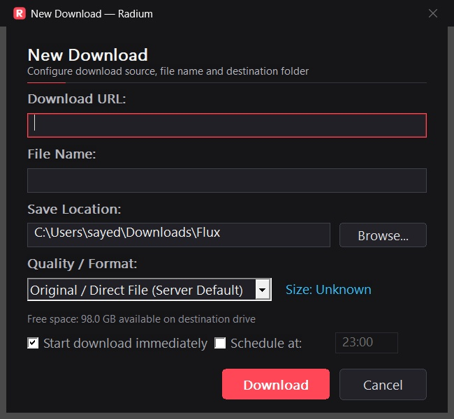
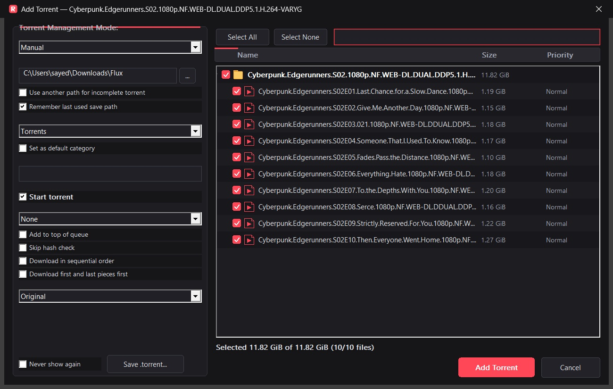
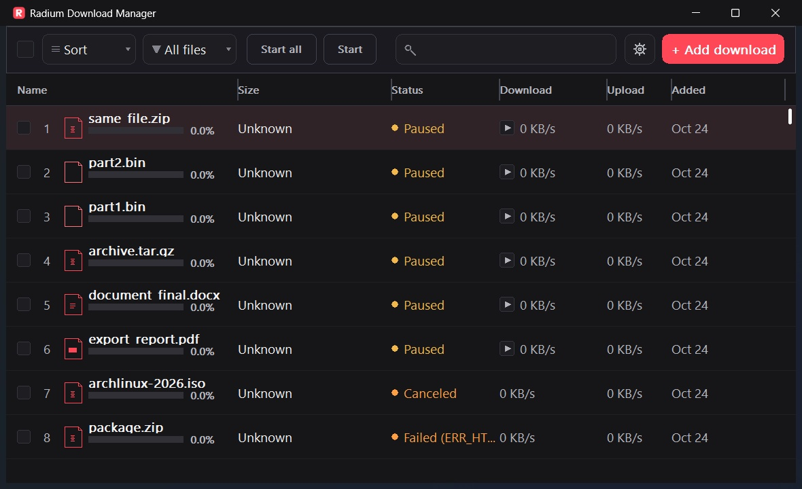
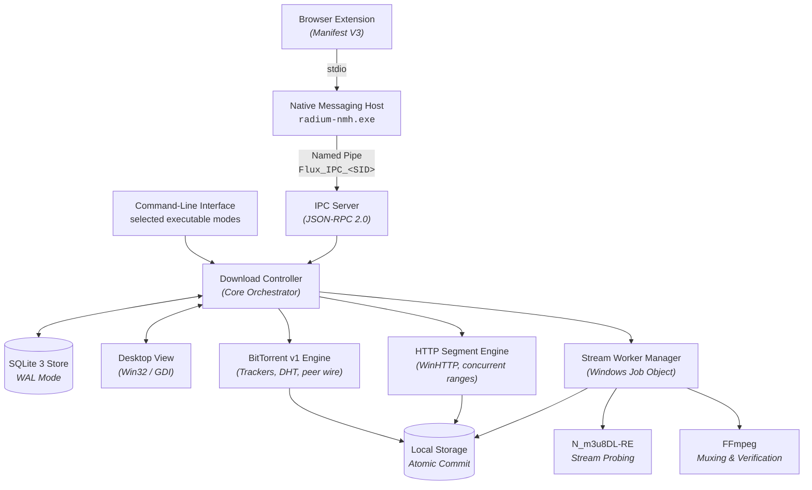

<p align="center">
  
</p>

<p align="center">
  <picture>
    
  </picture>
</p>

<h1 align="center">Radium Download Manager</h1>

<p align="center">
  <b>Fast, simple Windows 11 download manager with built-in video fetching.</b><br>
  Accelerate multi-connection file downloads and capture videos from supported browsers (HLS, DASH, and web streams).<br>
  Lightweight native C++20 &amp; Win32 app with zero Electron bloat, minimal RAM, and no background noise.
</p>

<p align="center">
  <a href="https://github.com/sayedalve/Radium-Download-Manager/releases/latest"></a>
  <a href="https://github.com/sayedalve/Radium-Download-Manager/releases/latest"></a>
  
  
  
  
  <a href="https://github.com/sayedalve/Radium-Download-Manager/actions/workflows/windows-release.yml"></a>
</p>

<p align="center">
  <a href="#quick-overview"><b>Overview</b></a> ·
  <a href="#downloads--installation"><b>Downloads</b></a> ·
  <a href="#key-features"><b>Features</b></a> ·
  <a href="#performance-benchmarks"><b>Benchmarks vs IDM</b></a> ·
  <a href="#high-performance-download-engine"><b>Download Engine</b></a> ·
  <a href="#bittorrent-downloads"><b>BitTorrent</b></a> ·
  <a href="#adaptive-stream-pipeline"><b>Stream Pipeline</b></a> ·
  <a href="#browser-integration"><b>Browser Capture</b></a> ·
  <a href="#under-the-hood"><b>Architecture</b></a> ·
  <a href="#testing-and-verification"><b>Verification</b></a> ·
  <a href="#license-and-credits"><b>License & Credits</b></a>
</p>

<br>

<p align="center">
  
  <br>
  <sub>The Radium main application window: Deep Charcoal dark theme, live segmented progress bars, speed and size telemetry, and category filters.</sub>
</p>

<br>

## Quick Overview

Radium is a lightweight, high-speed Windows 11 download manager designed to replace bulky, ad-filled alternatives. It combines high-speed multi-connection file downloads with one-click browser video fetching and stream muxing.

<table>
  <tr>
    <td width="25%" valign="top">
      <h3>⚡ Native Speed</h3>
      Zero Electron bloat. Written purely in C++20 with Win32 and Direct2D/GDI. Starts in milliseconds and maintains a minimal memory footprint (18–22 MB RAM peak during multi-gigabyte transfers).
    </td>
    <td width="25%" valign="top">
      <h3>🔀 Adaptive Engine</h3>
      Dynamic connection scaling (1 to 32 workers) with adaptive work stealing and hysteresis splitting. Measured 16.5% to 19.2% shorter completion times than IDM in 500 MB live transfer trials by eliminating late-stage connection churn.
    </td>
    <td width="25%" valign="top">
      <h3>🌐 Browser Capture</h3>
      Manifest V3 extension for Chrome, Brave, Edge, and Firefox. Sniffs progressive files and HLS/DASH media streams securely over per-user ACL-restricted Windows Named Pipes—zero unauthenticated localhost ports.
    </td>
    <td width="25%" valign="top">
      <h3>🧲 BitTorrent &amp; Streams</h3>
      Built-in BitTorrent v1 engine with metadata exchange (BEP 9), tracker announces, piece verification, and selective file tree downloads. Out-of-process stream muxing via N_m3u8DL-RE &amp; FFmpeg in isolated Windows Job Objects.
    </td>
  </tr>
</table>

<br>

## Downloads & Installation

The latest published release is **[v1.0.0](https://github.com/sayedalve/Radium-Download-Manager/releases/tag/v1.0.0)**. These packages are available for 64-bit Windows:

| Package | Architecture | Format | Description |
| :--- | :---: | :---: | :--- |
| **Radium Installer (Standard)** | x64 | [Setup (.exe)](https://github.com/sayedalve/Radium-Download-Manager/releases/download/v1.0.0/Radium-Setup-x64-1.0.0.exe) | Recommended installer for Windows 11 / 10 x64 |
| **Radium Portable Full** | x64 | [ZIP Archive](https://github.com/sayedalve/Radium-Download-Manager/releases/download/v1.0.0/Radium-v1.0.0-Windows-x64-Full.zip) | Portable package bundling N_m3u8DL-RE & FFmpeg stream workers |
| **Radium Portable Core** | x64 | [ZIP Archive](https://github.com/sayedalve/Radium-Download-Manager/releases/download/v1.0.0/Radium-v1.0.0-Windows-x64-Core.zip) | Core package; stream tools must be available separately |
| **Radium Core Installer** | x64 | [Setup (.exe)](https://github.com/sayedalve/Radium-Download-Manager/releases/download/v1.0.0/Radium-Setup-x64-Core-1.0.0.exe) | Lightweight installer without bundled stream binaries |
| **Radium Installer (ARM64)** | ARM64 | [Setup (.exe)](https://github.com/sayedalve/Radium-Download-Manager/releases/download/v1.0.0/Radium-Setup-ARM64-1.0.0.exe) | Native installer for Windows 11 on ARM |
| **Radium Portable Full (ARM64)** | ARM64 | [ZIP Archive](https://github.com/sayedalve/Radium-Download-Manager/releases/download/v1.0.0/Radium-v1.0.0-Windows-ARM64-Full.zip) | Portable package with ARM64 stream tools |
| **Browser Extension** | Cross-browser | [extension source](extension/) | Manifest V3 extension for Chrome, Brave, Edge & Firefox |

Cryptographic checksums for published release binaries are available in [SHA256SUMS.txt](https://github.com/sayedalve/Radium-Download-Manager/releases/download/v1.0.0/SHA256SUMS.txt).

### Browser Extension Setup

Browser extension installation is a **manual step** and is not completed automatically by the Radium installer. Install Radium first; the installer registers its Native Messaging Host, while the extension files are placed in the `extension` subfolder of the Radium installation directory.

For Chrome, Brave, or Edge, open `chrome://extensions`, `brave://extensions`, or `edge://extensions`, enable **Developer mode**, choose **Load unpacked**, and select `<Radium install folder>\extension`. For Firefox, open `about:debugging#/runtime/this-firefox`, choose **Load Temporary Add-on...**, and select `<Radium install folder>\extension\manifest.firefox.json`.

With a portable package, load the `extension` folder (or Firefox manifest) from the extracted package, then run `scripts\register-native-messaging.ps1` from that package folder. Open Radium and try downloading a file from a supported website to confirm the connection.

<br>

## Key Features

<table>
  <tr>
    <td width="50%" valign="top">
      
      <br>
      <sub>Instant Add Download prompt with pre-flight file probing, directory selection, and disk space guards.</sub>
      <h3>Smart Interception &amp; Pre-Flight Probing</h3>
      Whether triggered from the browser extension, clipboard URL detection, or manual URL entry, Radium validates requests before allocating bandwidth.
      <br><br>
      <b>Capabilities:</b>
      <ul>
        <li>Pre-flight header inspection (<code>HEAD</code>/<code>Range</code>) and RFC 5987 / 6266 filename decoding</li>
        <li>Real-time drive volume free-space calculation with safe disk pre-allocation</li>
        <li>Dynamic stream quality selection (Best, Video Only, Audio Only)</li>
        <li>Path traversal defense (strips <code>..</code> and NTFS alternate data streams <code>:</code>)</li>
      </ul>
    </td>
    <td width="50%" valign="top">
      
      <br>
      <sub>Native Add Torrent dialog with selective file tree selection, metadata inspection, and disk estimation.</sub>
      <h3>Native BitTorrent v1 Engine</h3>
      Add torrent files or magnet links directly. Radium inspects the metadata, presents the file hierarchy, and lets you select individual files to download.
      <br><br>
      <b>Capabilities:</b>
      <ul>
        <li>BEP 9 metadata retrieval for magnet links</li>
        <li>HTTP/UDP tracker announcements and bounded DHT peer discovery</li>
        <li>Interactive file tree with selective file downloading and size calculation</li>
        <li>SHA-1 piece verification and crash-resilient resume state</li>
      </ul>
    </td>
  </tr>
  <tr>
    <td colspan="2" valign="top">
      
      <br>
      <sub>Comprehensive Settings Center: Connection concurrency, category folder routing, proxy settings, and browser IPC status.</sub>
      <h3>Deep Configuration &amp; Native System Integration</h3>
      Customize every aspect of transfer behavior: configure connection limits (1–32), global speed limits, default download directories by file type, proxy routes (Direct, System, Manual), and browser integration rules.
    </td>
  </tr>
</table>

### Core Subsystem Hardening

- **Download Scheduling:** Deterministic local start/stop time windows, retry backoff with error classification, offline elapsed window reconciliation on restart, and post-queue actions (`SLEEP`/`SHUTDOWN`).
- **Speed Limiting:** In-process dual token-bucket rate limiting enforcing aggregate bandwidth caps across all concurrent connection workers for HTTP, FTP, and BitTorrent without thread starvation.
- **Site Grabber:** Bounded BFS crawler with depth (1–5) and page caps, HTML/CSS link extraction, redirect base URL propagation, and strict SSRF defenses against private/loopback/multicast destinations.
- **Antivirus Scanning:** Post-download Windows Defender (`MpCmdRun.exe`) validation with explicit threat detection, exit code 2 stdout discrimination, and strict mode (`av_strict_mode`) to fail unverified files on scanner error.
- **Automatic Categorization:** Deterministic rule precedence (Site Rules > Custom Extensions > Standard Filename > MIME Content-Type > General) with sanitized directory path routing.

<br>

## Performance Benchmarks

Radium is continuously evaluated against **Internet Download Manager (IDM 6.43.15)** and standard CLI tools using byte-exact payloads across both live internet endpoints and controlled local loopbacks.

### Head-to-Head: Radium (v0.3.5 Dev Build) vs Internet Download Manager (500 MB Live Internet)

The latest verified live internet benchmark evaluated both applications downloading an identical **500,000,000 byte** payload (`https://sg-lg.regxa.com/500MB.test`) on a Windows 11 host. Two sequential trials were run with reversed execution order to balance network transit variations.

> [!NOTE]
> **Build Identification:** The tested Radium executable was evaluated during development incorporating the adaptive range splitting policy now standard in **v1.0.0**. The previous baseline release was **v0.3.2**.

Both downloads completed successfully and passed exact cryptographic verification (**SHA-256:** `b16f001a0731c8636f163586c16276b3714b8977242b67ae05fa60b96f685ebc`).

| Trial | Order | Radium Duration | IDM Duration | Completion Time Reduction | Throughput (Radium / IDM) | Peak RAM (Radium / IDM) | Memory Reduction |
| :---: | :---: | :---: | :---: | :---: | :---: | :---: | :---: |
| **Trial 1** | IDM first, then Radium | **184.75 s** | 221.21 s | **16.48%** (-36.46 s) | **2.71 MB/s** / 2.26 MB/s (+19.91%) | **20.5 MB** / 53.8 MB | **61.90%** |
| **Trial 2** | Radium first, then IDM | **140.09 s** | 173.46 s | **19.24%** (-33.37 s) | **3.57 MB/s** / 2.88 MB/s (+23.96%) | **20.4 MB** / 122.2 MB | **83.31%** |
| **Mean** | Combined across trials | **162.42 s** | 197.34 s | **17.69%** (-34.92 s) | **3.14 MB/s** / 2.57 MB/s (+22.18%) | **20.4 MB** / 88.0 MB | **76.76%** |

```
500 MB Transfer Duration Comparison (Lower is Better)
─────────────────────────────────────────────────────────────────────────────
Trial 1 (IDM 1st):
  IDM 6.43.15     ████████████████████████████████████ 221.21 s
  Radium v0.3.5   ████████████████████████████ 184.75 s (-16.48% time)

Trial 2 (Radium 1st):
  IDM 6.43.15     ████████████████████████████ 173.46 s
  Radium v0.3.5   ██████████████████████ 140.09 s (-19.24% time)
─────────────────────────────────────────────────────────────────────────────
Combined Mean:
  IDM 6.43.15     ████████████████████████████████ 197.34 s
  Radium v0.3.5   ██████████████████████████ 162.42 s (17.69% shorter transfer time)
```

#### Measured Factors Influencing Transfer Efficiency:
1. **Adaptive Range Splitting:** The speed-based threshold expression is `clamp(4 × transfer_speed_bps × 0.25 s, 1 MiB, 16 MiB)`. The current scheduler uses the configured minimum split size with a 256 KiB floor while connections ramp up and a 1 MiB floor after concurrency is full. Benchmark records show discarded connection data fell by **57.3%** in Trial 1 (4.76 MB to 2.04 MB) and **42.4%** in Trial 2 (to 2.74 MB).
2. **Immediate Worker Parallelism:** Radium’s initial connection ramp-up dynamically allocates available workers to clean segment boundaries before transitioning to work-stealing mode. All 8 workers remained saturated throughout the transfer.
3. **Low-Overhead Native I/O:** Radium maintains pre-allocated sparse disk files and streaming disk commits via asynchronous WinHTTP I/O, using substantially less RAM (20.4–20.5 MB peak RSS vs IDM's 53.8–122.2 MB peak RSS across the trials). In Trial 2, IDM reached 122.2 MB during active segment assembly, whereas Radium avoided a post-processing assembly pass.

> [!NOTE]
> **Transparent Benchmark Context & Limitations:** Live internet benchmark results reflect real-world network transit to a single Singapore speed-test mirror (`sg-lg.regxa.com`). While network transit throughput varied across the trials (demonstrated by both applications completing faster in Trial 2), Radium achieved a **16.48% to 19.24% shorter completion time** in these specific back-to-back trials. These measurements establish performance under these specific network and server conditions, but do not claim universal superiority across all endpoints. Full raw metrics, trace logs, and verification tools are preserved in [`benchmarks/RESULTS.md`](benchmarks/RESULTS.md).

<details>
<summary><b>View Historical Benchmarks (100 MiB Rate-Limited & 2 GB Large-File)</b></summary>
<br>

#### 1. Historical 100 MiB Alternating Trials (Hetzner Falkenstein Rate-Limited)
Prior to the adaptive scheduler, Radium v0.3.2 and IDM were benchmarked across 10 alternating live trials on a 100 MiB payload (`fsn1-speed.hetzner.com`) under strict server rate-limiting:

| Metric | Radium v0.3.2 (Production Release) | IDM 6.43.15 | Delta / Notes |
| :--- | :---: | :---: | :--- |
| **Configured Concurrency** | 8 connections | 8 connections | Baseline |
| **Median Duration** | 79.44 s | 76.64 s | IDM faster by 2.80 s (3.53%) |
| **Median Throughput** | 1.26 MiB/s (10.56 Mbps) | 1.30 MiB/s (10.95 Mbps) | Parity (< 4% variance) |
| **Data Integrity (SHA-256)** | 5 / 5 (100% exact match) | 5 / 5 (100% exact match) | Exact match |
| **Peak Memory (RSS)** | 18.3 MB | 48.8 MB | Radium uses 62.5% less RAM |
| **Peak CPU Usage** | 15.6% | 56.2% | Radium uses 72.2% less peak CPU |

#### 2. Historical 2 GB Large-File ISO Transfer (AlmaLinux 8.10)
Tested on an authentic 2,140,143,616 byte ISO (`AlmaLinux-8.10-x86_64-minimal.iso`) with 8 configured connections:

| Metric | Radium v0.3.2 (Production Release) | IDM 6.43.15 | Delta / Notes |
| :--- | :---: | :---: | :--- |
| **Median Duration** | 596.20 s | 580.50 s | IDM faster by 15.70 s (2.70%) |
| **Median Throughput** | 3.60 MiB/s (3.78 MB/s) | 3.68 MiB/s (3.86 MB/s) | IDM +2.2% throughput |
| **Data Integrity (SHA-256)** | 2 / 2 (100% exact match) | 2 / 2 (100% exact match) | Exact match (`e524329700...`) |
| **Peak Memory (RSS)** | ~42–45 MB | ~58–61 MB | Radium uses ~26% less RAM |
| **Peak CPU Usage** | ~3.8–4.1% | ~5.2–5.8% | Radium uses ~27% less CPU |

See [`benchmarks/RESULTS.md`](benchmarks/RESULTS.md) and [`benchmarks/results/IDM_RADIUM_2GB_COMPARISON.md`](benchmarks/results/IDM_RADIUM_2GB_COMPARISON.md) for full trial records.
</details>

<br>

## High-Performance Download Engine

Radium implements an in-process, concurrent segmented HTTP/HTTPS download engine inspired by [Brisk](https://github.com/BrisklyDev/brisk), enhanced with an adaptive hysteresis splitting policy.

```
                      ┌────────────────────────────────────────┐
                      │        Target File (e.g. 500 MB)       │
                      └────────────────────────────────────────┘
                       /             |            |            \
       Worker 0 (0-125MB)   Worker 1 (125-250MB)  Worker 2     Worker 3
       [████████████████]   [████████░░░░░░░░]   [████░░░░]   [██░░░░░░]
                                     │
                      Worker 0 finishes early!
                      Steals remaining 50% from Worker 1:
                      Worker 0: [187.5 - 250 MB] ──► Spawns immediate connection
```

1. **Pre-flight Probe:** Sends a byte-range request to check range support, determine the content length, and extract server-suggested filenames.
2. **Initial Spawning:** Spawns an initial connection. If the server supports byte ranges, additional segment workers are spawned up to the configured connection limit (default 8, maximum 32).
3. **Adaptive Work-Stealing:** When a worker finishes its range, it can split the largest remaining block. The scheduler uses a 256 KiB floor while connections ramp up and a 1 MiB floor after reaching the configured concurrency.
4. **Rejection Rollback:** If a remote server rejects a sub-range request (e.g., returning HTTP 200 instead of 206, or HTTP 416), the stolen range is rolled back to the original worker without data corruption.
5. **Atomic Commit:** Download segments write into an isolated `*.radium.part` file using pre-allocated disk storage (`SetFileValidData` / sparse files). When all segments reach 100%, the file is atomically renamed to its final target path.

See [`docs/DOWNLOAD_ENGINE_DESIGN.md`](docs/DOWNLOAD_ENGINE_DESIGN.md) for full algorithmic details.

<br>

## BitTorrent Downloads

Radium includes a dedicated BitTorrent v1 engine for local `.torrent` files and magnet links:

- **Magnet Metadata Retrieval:** Implements BEP 9 extension protocol to fetch metadata for magnet URIs.
- **Tracker & DHT Discovery:** Supports HTTP and UDP tracker protocols alongside distributed hash table (DHT) peer discovery.
- **Piece Scheduling & Verification:** Requests blocks with end-game mode handling and validates SHA-1 piece hashes upon block assembly.
- **Selective File Trees:** Interactive dialog displays the full file and directory hierarchy, enabling selective file downloading and size estimation.
- **Crash Recovery:** BitTorrent task state and verified piece bitfields are saved in SQLite for instant restart recovery.

See [`docs/FEATURE_MATRIX.md`](docs/FEATURE_MATRIX.md) and [`docs/TEST_MATRIX.md`](docs/TEST_MATRIX.md).

<br>

## Adaptive Stream Pipeline

For media hosted via HLS or DASH manifests, Radium integrates out-of-process worker execution with [N_m3u8DL-RE](https://github.com/nilaoda/N_m3u8DL-RE) and [FFmpeg](https://ffmpeg.org/):

- **Job Object Sandboxing:** Workers run inside an isolated Windows Job Object (`JOB_OBJECT_LIMIT_KILL_ON_JOB_CLOSE`), ensuring that child processes terminate immediately if Radium closes.
- **Zero Command-Line Credential Leaks:** Authentication cookies, custom request headers, and user tokens are never passed on the process command line. Instead, Radium writes headers to a temporary response file (`@job.rsp`) in a per-user ACL-restricted temporary directory (`%LOCALAPPDATA%\Radium Download Manager\tmp\<task_id>\`) and deletes it upon completion.
- **Track Probing & Remuxing:** Radium probes stream manifests to identify video, audio, and subtitle streams. Once segment downloads complete, FFmpeg remuxes the media into standard MP4 or MKV containers with magic-byte verification.

See [`docs/STREAM_DOWNLOAD_PIPELINE.md`](docs/STREAM_DOWNLOAD_PIPELINE.md) for the complete pipeline specification.

DRM-protected streams are unsupported; Radium rejects recognized DRM signaling rather than attempting decryption.

<br>

## Browser Integration

Radium includes a clean, lightweight Manifest V3 extension compatible with Google Chrome, Brave, Microsoft Edge, and Mozilla Firefox.

```
┌─────────────────────────────────┐
│ Browser (Chromium / Firefox)    │
│  ├── webRequest Media Sniffing  │
│  └── Content Script Overlay     │
└───────────────┬─────────────────┘
                │ Native Messaging stdio (32-bit length-prefixed JSON)
┌───────────────▼─────────────────┐
│ radium-nmh.exe (Native Host)      │
└───────────────┬─────────────────┘
                │ Named Pipe: \\.\pipe\Flux_IPC_<UserSID>
┌───────────────▼─────────────────┐
│ radium.exe (Desktop Engine)     │
│  ├── Native Win32 / GDI Desktop │
│  ├── In-Process Segment Engine  │
│  └── SQLite 3 State Store (WAL) │
└─────────────────────────────────┘
```

- **Dual-Origin Security:** The Chromium native host manifest authorizes both store IDs and development keys, preventing native messaging connection failures when running unpacked.
- **Zero Localhost Exposure:** Unlike legacy download managers that open an unauthenticated HTTP port on `localhost` (exposing users to drive-by website requests), Radium communicates exclusively via Native Messaging bridged to a local, user-ACL-restricted Windows Named Pipe (`\\.\pipe\Flux_IPC_<UserSID>`, retained for extension compatibility).
- **Media Detection:** Sniffs `.mp4`, `.webm`, `.m3u8`, and `.mpd` URLs from network requests, deduplicates master and variant playlists, and ignores individual `.ts` and `.m4s` segment requests to prevent UI flooding.
- **Reliable Fallback & Gesture Safety:** Link clicks retain user gesture context without destructive cancellation. In Chromium browsers, `onDeterminingFilename` holds the save prompt while querying the desktop; if Radium is offline or rejects, the browser download automatically resumes with zero data loss. Client-side generated files (`blob:`, `data:` URLs, ChatGPT exports) are safely preserved for native browser handling without DOM monkey-patching.

See [`docs/BROWSER_EXTENSION.md`](docs/BROWSER_EXTENSION.md) and [`docs/NATIVE_MESSAGING_AND_IPC.md`](docs/NATIVE_MESSAGING_AND_IPC.md).

<br>

## Under the Hood



### Core Design Principles
- **Native Efficiency:** Compiled with MSVC 19.38+ (`/std:c++20`, `/permissive-`, `/W4`, `/WX`). Unicode everywhere via `std::wstring` at Win32 boundaries and UTF-8 internally.
- **Process Isolation:** Network streaming and FFmpeg muxing are isolated out-of-process inside Windows Job Objects. A crashed stream decoder will never crash the desktop application or corrupt existing downloads.
- **Zero Hallucination State:** Download progress, byte offsets, and active segment partitions are tracked in real-time in SQLite. If power is lost, Radium recovers segment maps upon restart.
- **Single-Instance Win32 IPC:** Launching `radium.exe` while an existing instance is active automatically restores and brings the existing window to the foreground.

See [`docs/SYSTEM_ARCHITECTURE.md`](docs/SYSTEM_ARCHITECTURE.md) and [`docs/DATA_MODEL_AND_STORAGE.md`](docs/DATA_MODEL_AND_STORAGE.md).

<br>

## Building from Source

To compile Radium from source, use **Windows 11**, **Visual Studio 2022** (Desktop development with C++), and **CMake 3.25 or newer**:

```powershell
git clone https://github.com/sayedalve/Radium-Download-Manager.git
cd Radium-Download-Manager
cmake -B build/win-x64 -A x64
cmake --build build/win-x64 --config Release
```

The compiled binaries will be output to `build/win-x64/Release/`. See [`docs/DEVELOPMENT_SETUP.md`](docs/DEVELOPMENT_SETUP.md) and [`docs/WINDOWS_BUILD_AND_PACKAGING.md`](docs/WINDOWS_BUILD_AND_PACKAGING.md).

<br>

## Testing and Verification

Radium maintains comprehensive automated C++ unit and integration tests covering the download engine, work-stealing scheduler, BitTorrent parser, and storage:

```powershell
.\build\win-x64\Release\radium_unit_tests.exe
```

The repository includes C++ regression, browser extension, and integration suites. See the test matrix for coverage and recorded verification:
- [Feature matrix](docs/FEATURE_MATRIX.md)
- [Test matrix](docs/TEST_MATRIX.md)
- [Windows release workflow](https://github.com/sayedalve/Radium-Download-Manager/actions/workflows/windows-release.yml)

<br>

## HTTP Server Compatibility

Radium uses segmented downloads only after the server confirms valid `206 Partial Content` range responses. When range support is unavailable, it uses a single connection. If a later range request returns `200 OK` or invalid range data, Radium rejects that response before writing it and returns unstarted work for safe continuation. Resumes use saved progress and remote validators when available; changed resources may need to restart. Support depends on the server and resource.

## Contributing

Bug reports and focused pull requests are welcome. Please read [CONTRIBUTING.md](CONTRIBUTING.md) and follow the repository guidance in [AGENTS.md](AGENTS.md).

<br>

## License and Credits

Radium Download Manager is open-source software licensed under the **Apache License, Version 2.0** ([Apache-2.0](LICENSE)).

### Third-Party Components & Attributions
Radium incorporates or interoperates with the following third-party components and utilities:

| Component | Project / Source | License | Purpose in Radium |
|---|---|---|---|
| **Stream Extraction** | [N_m3u8DL-RE](https://github.com/nilaoda/N_m3u8DL-RE) | MIT | Out-of-process HLS/DASH stream segment downloader |
| **Container Muxing** | [FFmpeg](https://ffmpeg.org/) | LGPL-2.1+ / LGPL-3.0 | Out-of-process video/audio segment demuxing and container remuxing |
| **RAII Wrappers** | [Microsoft WIL](https://github.com/microsoft/wil) | MIT | Windows Implementation Libraries for exception-safe Win32 handles |
| **State Database** | [SQLite](https://www.sqlite.org/) | Public Domain | Embedded ACID-compliant database with Write-Ahead Logging (WAL) |
| **JSON Engine** | [nlohmann/json](https://github.com/nlohmann/json) | MIT | Structured JSON serialization for IPC and task import/export |

See [`THIRD_PARTY_NOTICES.md`](THIRD_PARTY_NOTICES.md) and [`NOTICE`](NOTICE).

<br>

<p align="center">
  <sub>Radium Download Manager · High-performance, native open-source download management for Windows.</sub><br>
  <sub>Built with C++20 and Win32. Licensed under Apache-2.0.</sub>
</p>
