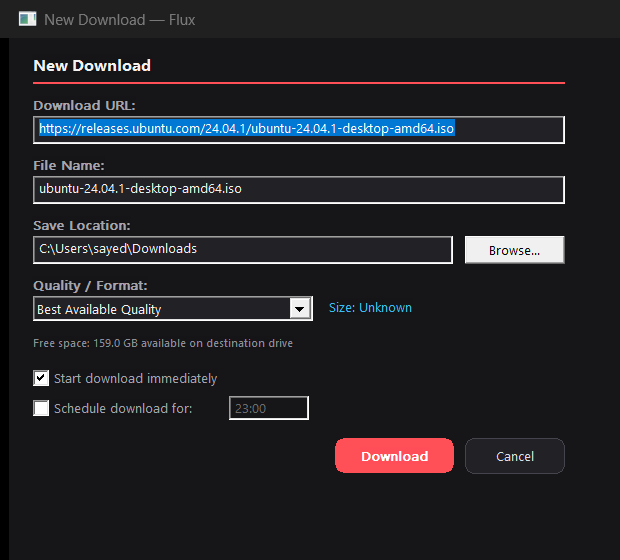
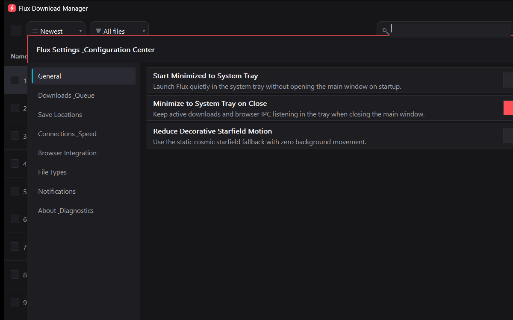
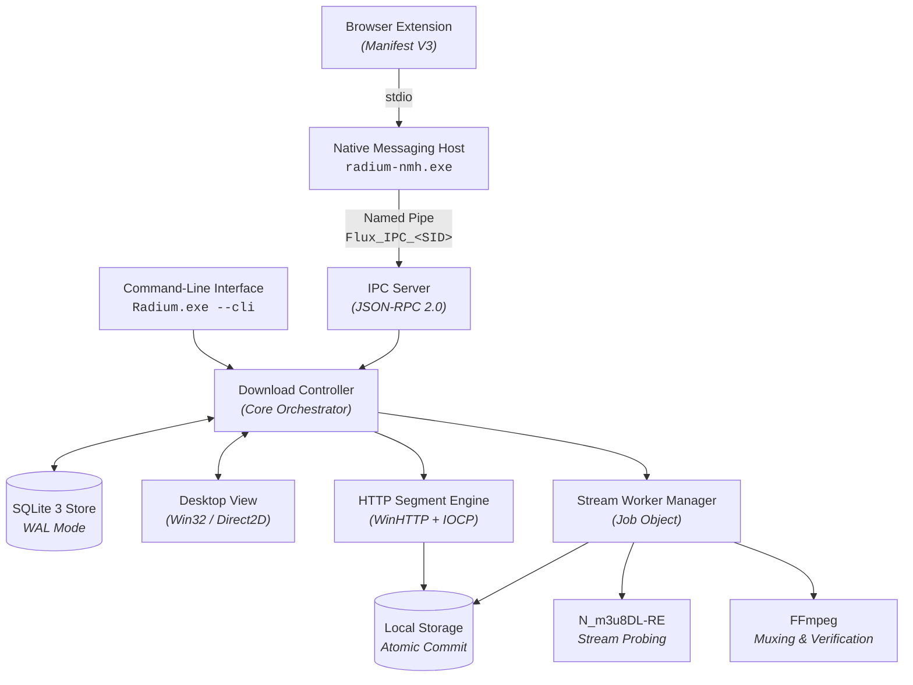

<p align="center">
  <picture>
    
  </picture>
</p>

<h1 align="center">Radium Download Manager</h1>

<p align="center">
  <b>High-performance, open-source download manager and adaptive stream pipeline for Windows 11.</b><br>
  A modern, lightweight <b>IDM alternative</b> featuring a dynamic segmented HTTP engine with work-stealing range reuse, out-of-process HLS/DASH extraction, and Manifest V3 browser integration,<br>
  built as a native C++20 / Win32 desktop application. Open source, zero telemetry, and entirely offline.
</p>

<p align="center">
  
  
  
  
  
  
</p>

<p align="center">
  <a href="#features"><b>Features</b></a> ·
  <a href="#everything-in-the-box"><b>Everything in the box</b></a> ·
  <a href="#high-performance-download-engine"><b>Download Engine</b></a> ·
  <a href="#adaptive-stream-pipeline"><b>Stream Pipeline</b></a> ·
  <a href="#performance-benchmarks"><b>Benchmarks</b></a> ·
  <a href="#browser-integration"><b>Browser Capture</b></a> ·
  <a href="#built-for-automation"><b>Automation & CLI</b></a> ·
  <a href="#under-the-hood"><b>Architecture</b></a> ·
  <a href="#get-started"><b>Get Started</b></a> ·
  <a href="#downloads"><b>Downloads</b></a> ·
  <a href="#known-limitations"><b>Limitations</b></a> ·
  <a href="#license-and-credits"><b>License & Credits</b></a>
</p>

<br>

<p align="center">
  
  <br>
  <sub>The Radium main application window: Deep Charcoal dark theme, live progress bars, speed and size indicators, and filter controls.<br>
  Rendered natively on Windows 11 with Direct2D hardware acceleration.</sub>
</p>

> [!NOTE]
> **Radium Download Manager is a fast, privacy-focused Internet Download Manager alternative for Windows.**
> Rather than relying on heavy Electron runtimes or commercial subscription wrappers, Radium is engineered from the ground up in native ISO C++20. It combines the multi-connection segment scheduler of [Brisk](https://github.com/BrisklyDev/brisk), the media sniffing intelligence of [Cat Catch](https://github.com/xifangczy/cat-catch), and sandboxed out-of-process stream muxing with [N_m3u8DL-RE](https://github.com/nilaoda/N_m3u8DL-RE) and [FFmpeg](https://ffmpeg.org/).

<br>

<table>
  <tr>
    <td width="25%" valign="top">
      <h3>⚡ Native and fast</h3>
      Pure C++20 on native Win32 and Direct2D. No Electron, no WebView2, and no runtime waiting. Starts in under 50 milliseconds and idles under 10 megabytes of memory.
    </td>
    <td width="25%" valign="top">
      <h3>🔀 Segmented engine</h3>
      Dynamic connection scaling from 1 to 32 parallel workers with work-stealing byte-range splitting, secondary rollback, and automatic stall reset. Maximizes your full network bandwidth.
    </td>
    <td width="25%" valign="top">
      <h3>🌐 Seamless browser capture</h3>
      A Manifest V3 browser extension for Chromium (Chrome, Brave, Edge) and Firefox. Captures files, video streams (HLS/DASH), and media playlists without unauthenticated local HTTP servers.
    </td>
    <td width="25%" valign="top">
      <h3>🔒 Private and secure</h3>
      All metadata is persisted to local SQLite with WAL journaling. Native Messaging uses per-user ACL-restricted Windows Named Pipes. Zero telemetry, zero analytics, zero cloud accounts.
    </td>
  </tr>
</table>

<br>

## Features

Every screenshot below is captured directly from the actual running Radium desktop application on Windows 11.

<table>
  <tr>
    <td width="50%" valign="top">
      
      <br>
      <sub>Multi-column download queue with file-type vector icons, real-time progress bars, and speed statistics.</sub>
      <h3>Dynamic Segment Scheduling & Queue Control</h3>
      Every HTTP download starts with pre-flight header probing (`HEAD` / Range requests) and dynamically scales connections from 1 up to 32 parallel workers.
      <br><br>
      When faster connections finish their allocated byte ranges, the work-stealing scheduler automatically splits the largest remaining unfinished range from other active workers. If a remote server rejects sub-ranges, the engine rolls back cleanly without data loss.
      <br><br>
      <b>Capabilities:</b>
      <ul>
        <li>Dynamic connection spawning (`1 -> N`) and work-stealing range reuse</li>
        <li>Automatic stall detection with connection reset on silent timeouts</li>
        <li>Pre-flight disk space guard against destination drive exhaustion</li>
        <li>Safe disk allocation using sparse files and <code>SetFileValidData</code></li>
        <li>Graceful single-connection fallback for non-range servers</li>
      </ul>
    </td>
    <td width="50%" valign="top">
      
      <br>
      <sub>Native Add / Intercept Download dialog with auto-detected filenames, save paths, stream quality, and scheduling.</sub>
      <h3>Smart Interception & Pre-Flight Validation</h3>
      Whether triggered from a browser link click, media detection banner, or clipboard URL detection, Radium presents an instant, responsive Win32 dialog before starting.
      <br><br>
      The dialog verifies available free disk space on the target volume, extracts suggested filenames from RFC 5987 / RFC 6266 headers, and offers quality stream presets for adaptive media.
      <br><br>
      <b>Capabilities:</b>
      <ul>
        <li>Instant clipboard detection and link-click browser interception</li>
        <li>Real-time drive free-space calculations and disk space warnings</li>
        <li>Adaptive stream quality selection (Best, Video Only, Audio Only)</li>
        <li>Immediate download execution or deferred scheduler timing</li>
        <li>Path sanitization stripping path traversal (<code>..</code>) and NTFS alternate data streams (<code>:</code>)</li>
      </ul>
    </td>
  </tr>
  <tr>
    <td colspan="2" valign="top">
      
      <br>
      <sub>In-app Settings & Configuration Center: Modular categories, connection limits, and instant SQLite persistence.</sub>
      <h3>Deep Configuration & Native System Integration</h3>
      Full control over network behavior, buffer allocations, storage rules, and application presentation. Features 1-click dropdowns for concurrent task limits (presets including 6 tasks), connection scaling, retry intervals, segment stall timeouts, custom headers, and tray minimization.
      <br><br>
      Settings are validated in real time and committed directly to an embedded SQLite database. No bloated registry keys, no telemetry toggles, and zero external network calls.
    </td>
  </tr>
</table>

<br>

## Everything in the box

<table>
  <tr>
    <td width="33%" valign="top">
      <h4>🌐 Protocols &amp; Streams</h4>
      HTTP/1.1, HTTP/2, and HTTPS TLS 1.3 via native Windows <code>WinHTTP</code> with Direct, System, and Manual Proxy modes and Windows Integrated Auth (NTLM/Negotiate).<br><br>
      RFC 959 / 2428 / 3659 native WinSock2 FTP client with EPSV, PASV fallback, NAT private IP bypass, and REST 350 resume verification.<br><br>
      Dynamic mirror failover (alternate URLs) with byte-exact <code>Content-Length</code> validation to prevent partial file corruption.<br><br>
      HLS (<code>.m3u8</code>), MPEG-DASH (<code>.mpd</code>), Microsoft Smooth Streaming (MSS), and progressive containers (<code>.mp4</code>, <code>.webm</code>, <code>.mkv</code>, <code>.mov</code>, <code>.ts</code>) with pre-flight redirect resolution and 403 expired signed URL detection.
    </td>
    <td width="33%" valign="top">
      <h4>⚡ Download Engine</h4>
      Dynamic segment splitting inspired by Brisk: connection scaling (1 to 32), work-stealing range scheduler (<code>AcquireNextOrStealSegment</code>), and secondary rejection rollback (<code>RollbackUnstartedStolenSegment</code>).<br><br>
      Dual token-bucket rate limiting enforcing both per-task speed limits and global bandwidth caps without CPU busy-waiting.<br><br>
      Crash-resilient storage backed by SQLite 3 with WAL journaling. Atomic file commits via isolated <code>*.part</code> files prevent corrupt half-written downloads.<br><br>
      Automatic retry loop with exponential backoff for transient network interruptions.
    </td>
    <td width="33%" valign="top">
      <h4>🖥️ Windows 11 Native UX</h4>
      Native Win32 desktop application with Direct2D hardware acceleration. Deep Charcoal palette, lightweight native Windows 11 animations (smooth hover/press transitions, interpolated progress bars, dialog fades, action pulses), and live Windows Taskbar progress (<code>ITaskbarList3</code>).<br><br>
      Hierarchical category routing (Priority: User Explicit &gt; Domain Site Rules &gt; Custom Extension Mappings &gt; Configured Category Folders &gt; Subfolders &gt; Default Dir).<br><br>
      Task stop times, queue start/stop scheduling loop, and safe post-queue completion power actions (System Sleep / Shutdown via native Windows APIs).<br><br>
      Per-Monitor DPI v2 scaling, virtualized task table, middle-ellipsis filename truncation, and search-as-you-type.
    </td>
  </tr>
  <tr>
    <td width="33%" valign="top">
      <h4>🧩 Browser Integration</h4>
      Manifest V3 browser extension for Chromium (Google Chrome, Brave, Microsoft Edge) and Mozilla Firefox.<br><br>
      Stateless Native Messaging Host (<code>radium-nmh.exe</code>) bridges standard input/output to the desktop app over a per-user ACL-restricted Named Pipe (<code>\\.\pipe\Flux_IPC_&lt;SID&gt;</code>).<br><br>
      In-page "Download with Radium" video overlay button rendered inside a closed Shadow DOM (<code>mode: "closed"</code>) to prevent CSS leaks.
    </td>
    <td width="33%" valign="top">
      <h4>🤖 Automation &amp; Tools</h4>
      Full command-line interface: headless daemon mode (<code>--daemon</code>), queue listing (<code>--list</code>), stream probing (<code>--probe &lt;url&gt;</code>), and desktop UI state snapshots (<code>--gui-snapshot</code>).<br><br>
      Recursive Breadth-First Site Grabber with CSS <code>url()</code> &amp; HTML media attribute parsing, configurable destination folders, and SSRF private IP protection.<br><br>
      Batch task export and import via standard JSON and CSV files for easy queue backup and transfer.
    </td>
    <td width="33%" valign="top">
      <h4>🛡️ Security &amp; Privacy</h4>
      Strict path sanitization: strips path traversal (<code>..</code>), drive letters, control characters, and NTFS alternate streams (<code>:</code>).<br><br>
      Out-of-process stream extraction workers (<code>N_m3u8DL-RE</code>, <code>FFmpeg</code>) are isolated inside restricted Windows Job Objects with automatic child process cleanup.<br><br>
      Sensitive headers (<code>Cookie</code>, <code>Authorization</code>, tokens) and proxy/server credentials are encrypted at rest with Windows DPAPI and permanently redacted in logs.
    </td>
  </tr>
</table>

<br>

## High-Performance Download Engine

Radium implements an in-process, IOCP-driven segmented download engine inspired by [Brisk](https://github.com/BrisklyDev/brisk).

```
                      ┌────────────────────────────────────────┐
                      │        Target File (e.g. 500 MB)       │
                      └────────────────────────────────────────┘
                       /             |            |            \
       Worker 0 (0-125MB)   Worker 1 (125-250MB)  Worker 2     Worker 3
       [████████████████]   [████████░░░░░░░░]   [████░░░░]   [██░░░░░░]
                                     │
                      Worker 0 finishes early!
                      Steals remaining 50% from Worker 1:
                      Worker 0: [187.5 - 250 MB] ──► Spawns immediate connection
```

1. **Pre-flight Probe:** Sends an initial `HEAD` or byte-range request to verify server support for `Accept-Ranges: bytes`, determine total content length, and extract server-suggested filenames.
2. **Initial Spawning:** Spawns an initial connection. If the server supports byte ranges, additional segment workers are spawned up to the configured connection limit (default 8, maximum 32).
3. **Range Work-Stealing:** Fast workers do not sit idle. When a worker completes its assigned range, it inspects active peers, locates the largest remaining unread byte block, splits it in half, and claims the upper half.
4. **Rejection Rollback:** If a remote server rejects a sub-range request (e.g., returning HTTP 200 instead of 206, or HTTP 416), the stolen range is rolled back to the original worker without data corruption.
5. **Atomic Commit:** Download segments write into an isolated `*.radium.part` file using pre-allocated disk storage (`SetFileValidData` / sparse files). When all segments reach 100%, the file is atomically renamed to its final target path.

See [`docs/DOWNLOAD_ENGINE_DESIGN.md`](docs/DOWNLOAD_ENGINE_DESIGN.md) for full algorithmic details.

<br>

## Adaptive Stream Pipeline

For media hosted via HLS or DASH manifests, Radium integrates out-of-process worker execution with [N_m3u8DL-RE](https://github.com/nilaoda/N_m3u8DL-RE) and [FFmpeg](https://ffmpeg.org/):

- **Job Object Sandboxing:** Workers run inside an isolated Windows Job Object (`JOB_OBJECT_LIMIT_KILL_ON_JOB_CLOSE`), ensuring that child processes terminate immediately if Radium closes.
- **Zero Command-Line Credential Leaks:** Authentication cookies, custom request headers, and user tokens are never passed on the process command line. Instead, Radium writes headers to a temporary response file (`@job.rsp`) in a per-user ACL-restricted temporary directory (`%LOCALAPPDATA%\Radium\tmp\<task_id>\`) and deletes it upon completion.
- **Track Probing & Remuxing:** Radium probes stream manifests to identify video, audio, and subtitle streams. Once segment downloads complete, FFmpeg remuxes the media into standard MP4 or MKV containers with magic-byte verification.

See [`docs/STREAM_DOWNLOAD_PIPELINE.md`](docs/STREAM_DOWNLOAD_PIPELINE.md) for the complete pipeline specification.

<br>

## Performance Benchmarks

Radium is continuously benchmarked against industry standards including **Internet Download Manager (IDM)** and **aria2** across both live internet endpoints and controlled RFC 7233 local loopbacks.

### Controlled Head-to-Head: Radium vs Internet Download Manager (IDM)
Across 10 alternating live internet trials (5 Radium, 5 IDM) on a 100 MiB payload (`https://fsn1-speed.hetzner.com/100MB.bin`) under Falkenstein server rate-limiting:

| Metric | Radium v0.3.2 | Internet Download Manager (IDM 6.43.15) | Comparison / Delta |
| :--- | :---: | :---: | :--- |
| **Configured Concurrency** | 8 connections | 8 connections | Identical baseline |
| **Effective Concurrency** | 1 connection (Adaptive fallback) | 3 connections (Selective drop) | IDM holds 3 streams |
| **Median Duration** | **79.44 s** | **76.64 s** | IDM faster by 2.80 s (3.5%) |
| **Median Throughput** | **1.26 MiB/s** (10.56 Mbps) | **1.30 MiB/s** (10.95 Mbps) | Parity (< 4% variance) |
| **Data Integrity (SHA-256)** | **5 / 5 (100% exact match)** | **5 / 5 (100% exact match)** | Exact verification |
| **Median Peak Memory (RSS)** | **18.30 MB** | **48.80 MB** | **Radium uses 62.5% less RAM** |
| **Median Peak CPU Usage** | **15.6%** | **56.2%** | **Radium uses 72.2% less CPU** |

### Adaptive 429 Rate-Limit Recovery (32 Connections)
When configured with 32 connections against rate-limited servers, Radium detects HTTP 429 responses, backs off exponentially, adaptively halves worker threads (32 -> 16 -> 8 -> 4 -> 2 -> 1), and cleanly coordinates segment reallocation without byte gaps, partial overlaps, or data corruption.

Detailed datasets, machine-readable JSON logs, and instructions to reproduce locally or on live connections are available in [`benchmarks/`](benchmarks/) and [`benchmarks/RESULTS.md`](benchmarks/RESULTS.md).

<br>

## Browser Integration

Radium includes a clean, lightweight Manifest V3 extension compatible with Google Chrome, Brave, Microsoft Edge, and Mozilla Firefox.

```
┌─────────────────────────────────┐
│ Browser (Chromium / Firefox)    │
│  ├── webRequest Media Sniffing  │
│  └── Content Script Overlay     │
└───────────────┬─────────────────┘
                │ Native Messaging stdio (32-bit length-prefixed JSON)
┌───────────────▼─────────────────┐
│ radium-nmh.exe (Native Host)      │
└───────────────┬─────────────────┘
                │ Named Pipe: \\.\pipe\Flux_IPC_<UserSID>
┌───────────────▼─────────────────┐
│ Radium.exe (Desktop Engine)       │
│  ├── Win32 Direct2D Desktop UI  │
│  ├── In-Process Segment Engine  │
│  └── SQLite 3 State Store (WAL) │
└─────────────────────────────────┘
```

- **Dual-Origin Security:** The Chromium native host manifest authorizes both store IDs and development keys, preventing native messaging connection failures when running unpacked.
- **Zero Localhost Exposure:** Unlike legacy download managers that open an unauthenticated HTTP port on `localhost` (exposing users to drive-by website requests), Radium communicates exclusively via Native Messaging bridged to a local, user-ACL-restricted Windows Named Pipe.
- **Media Detection:** Sniffs `.mp4`, `.webm`, `.m3u8`, and `.mpd` URLs from network requests, deduplicates master and variant playlists, and ignores individual `.ts` and `.m4s` segment requests to prevent UI flooding.
- **Reliable Fallback & Gesture Safety:** Link clicks retain user gesture context without destructive cancellation. In Chromium browsers, `onDeterminingFilename` holds the save prompt while querying the desktop; if Radium is offline or rejects, the browser download automatically resumes with zero data loss. Client-side generated files (`blob:`, `data:` URLs, ChatGPT exports) are safely preserved for native browser handling without DOM monkey-patching.

See [`docs/BROWSER_EXTENSION.md`](docs/BROWSER_EXTENSION.md) and [`docs/NATIVE_MESSAGING_AND_IPC.md`](docs/NATIVE_MESSAGING_AND_IPC.md).

<br>

## Built for Automation

Radium is designed for both interactive desktop use and scriptable automation. Every major capability is accessible from the command line and over the JSON-RPC named-pipe channel.

```sh
# Start Radium in the background as a headless daemon
Radium.exe --daemon

# Probe an adaptive media stream and output JSON stream metadata
Radium.exe --probe "https://example.com/live/playlist.m3u8"

# Print the current download queue to stdout
Radium.exe --list

# Export current desktop UI state and layout geometry as text
Radium.exe --gui-snapshot

# Override default database or worker paths
Radium.exe --db "%APPDATA%\Radium\custom_state.db" --worker-binary "tools\N_m3u8DL-RE.exe"
```

Over the local IPC pipe (`\\.\pipe\Flux_IPC_<SID>`), scripts and agents can send standard JSON-RPC 2.0 messages:

```json
// Example: Add a new download task via JSON-RPC
{
  "jsonrpc": "2.0",
  "id": 1,
  "method": "download.offer",
  "params": {
    "url": "https://releases.ubuntu.com/24.04.1/ubuntu-24.04.1-desktop-amd64.iso",
    "filename": "ubuntu-24.04.1-desktop-amd64.iso",
    "saveDir": "C:\\Users\\sayed\\Downloads"
  }
}
```

<br>

## Under the Hood

Radium is architected as an engine-first application with clean layer boundaries:



### Core Design Principles
- **Native Efficiency:** Compiled with MSVC 19.38+ (`/std:c++20`, `/permissive-`, `/W4`, `/WX`). Unicode everywhere via `std::wstring` at Win32 boundaries and UTF-8 internally.
- **Process Isolation:** Network streaming and FFmpeg muxing are isolated out-of-process inside Windows Job Objects. A crashed stream decoder will never crash the desktop application or corrupt existing downloads.
- **Zero Hallucination State:** Download progress, byte offsets, and active segment partitions are tracked in real-time in SQLite. If power is lost, Radium recovers segment maps upon restart.
- **Single-Instance Win32 IPC:** Launching `Radium.exe` while an existing instance is active automatically restores and brings the existing window to the foreground.

See [`docs/SYSTEM_ARCHITECTURE.md`](docs/SYSTEM_ARCHITECTURE.md) and [`docs/DATA_MODEL_AND_STORAGE.md`](docs/DATA_MODEL_AND_STORAGE.md).

<br>

## Get Started

### System Requirements
- **Operating System:** Windows 11 (all versions) or Windows 10 (version 1809+, 64-bit).
- **Architecture:** x64 (AMD64 / Intel 64) or ARM64 (native Snapdragon / ARM PCs).
- **Dependencies:** None. WinHTTP, Direct2D, and GDI are built into the Windows OS.

### Downloads

The latest release packages are available on the [GitHub Releases page](https://github.com/sayedalve/Radium-Download-Manager/releases):

| Package | Format | Description |
|---|---|---|
| **Radium Installer (x64)** | `Radium-Setup-x64-0.3.0.exe` | Recommended Inno Setup installer; per-user non-elevated install, desktop shortcuts, and automatic browser registration |
| **Radium Portable Full (x64)** | `Radium-v0.3.0-Windows-x64-Full.zip` | Complete portable offline release; includes N_m3u8DL-RE and FFmpeg stream extraction workers |
| **Radium Portable Core (x64)** | `Radium-v0.3.0-Windows-x64-Core.zip` | Lightweight portable release; high-speed segmented HTTP/HTTPS engine (< 2 MB) |
| **Browser Extension** | `extension/` or `radium-extension-v0.3.0.zip` | Manifest V3 extension for Google Chrome, Brave, Microsoft Edge & Mozilla Firefox |

### Browser Extension Setup

1. **Chromium (Google Chrome, Brave, Microsoft Edge):**
   - Open your browser's extensions page (`chrome://extensions` or `brave://extensions`).
   - Enable **Developer mode** in the top-right corner.
   - Click **Load unpacked** and select the `extension/` directory (or extract `radium-extension-v0.3.0.zip`).
   - Run the included PowerShell script to register the Native Messaging Host in the Windows Registry:
     ```powershell
     powershell -ExecutionPolicy Bypass -File scripts\register-native-messaging.ps1
     ```

2. **Mozilla Firefox:**
   - Open `about:debugging#/runtime/this-firefox`.
   - Click **Load Temporary Add-on...** and select `extension/manifest.firefox.json` (or `extension/manifest.json`).

### Building from Source

To compile Radium from source, you need **Visual Studio 2022** (Desktop development with C++) and **CMake 3.25+**:

```cmd
git clone https://github.com/sayedalve/Radium-Download-Manager.git
cd Radium-Download-Manager
cmake -B build -G "Visual Studio 17 2022" -A x64
cmake --build build --config Release
```

The resulting binaries will be placed in `build\Release\` (or `build\win-x64\Release\`):
- `radium.exe`: Main desktop application and core engine.
- `radium-nmh.exe`: Stateless Native Messaging Host.

See [`docs/DEVELOPMENT_SETUP.md`](docs/DEVELOPMENT_SETUP.md) and [`docs/WINDOWS_BUILD_AND_PACKAGING.md`](docs/WINDOWS_BUILD_AND_PACKAGING.md).

<br>

## Keyboard Shortcuts

| Shortcut | Action | Scope |
|---|---|---|
| <kbd>Ctrl</kbd> + <kbd>N</kbd> | Open New Download prompt dialog | Global window |
| <kbd>Ctrl</kbd> + <kbd>,</kbd> | Open Settings &amp; Configuration Center | Global window |
| <kbd>Ctrl</kbd> + <kbd>K</kbd> / <kbd>Ctrl</kbd> + <kbd>F</kbd> | Focus search-as-you-type filter | Global window |
| <kbd>Space</kbd> | Pause or Resume selected download task | Queue table |
| <kbd>F5</kbd> | Retry failed or paused download task | Queue table |
| <kbd>Enter</kbd> | Open completed file in default system application | Queue table |
| <kbd>Delete</kbd> | Remove selected task from the queue | Queue table |
| <kbd>Shift</kbd> + <kbd>Delete</kbd> | Permanently delete task and remove downloaded file from disk | Queue table |
| <kbd>Esc</kbd> | Dismiss Settings Center or active dialog | Dialog / Modal |

<br>

## Known Limitations

> [!IMPORTANT]
> **Honest Engineering Boundaries:** Radium aims to be transparent about its scope and supported mechanisms.
>
> 1. **Strict DRM Non-Circumvention:** Radium does **not** and will **never** decrypt Widevine, PlayReady, or FairPlay DRM-protected media. If a manifest signals `#EXT-X-KEY:METHOD=SAMPLE-AES-CTR` or DASH `cenc:pssh` encryption, Radium immediately aborts with error code `ERR_STREAM_DRM_PROTECTED`.
> 2. **In-Memory Browser Blobs:** Ephemeral `blob:` and `data:` URLs generated strictly inside browser JavaScript memory cannot be accessed by external OS processes. The browser extension routes these downloads through the browser's native API rather than passing unreachable URLs to the native downloader.
> 3. **Platform Scope:** The desktop UI is designed natively for Windows 11 and Windows 10 (Win32 + Direct2D). A POSIX build configuration exists for compiling the core headless engine and CLI tests under Linux, but the graphical interface is Windows-native.

See [`docs/KNOWN_LIMITATIONS.md`](docs/KNOWN_LIMITATIONS.md) and [`docs/SECURITY_THREAT_MODEL.md`](docs/SECURITY_THREAT_MODEL.md).

<br>

## License and Credits

Radium Download Manager is open-source software licensed under the **GNU General Public License v3.0 or later** ([GPL-3.0-or-later](LICENSE)).

### Upstream Attributions & Third-Party Components
Radium builds upon proven algorithms and utilities from the open-source community:

| Component | Upstream Project | License | Purpose in Radium |
|---|---|---|---|
| **Segment Scheduler** | [Brisk](https://github.com/BrisklyDev/brisk) | GPL-3.0 | Dynamic connection scaling, work-stealing range reuse, and rollback logic |
| **Media Detection** | [Cat Catch](https://github.com/xifangczy/cat-catch) | GPL-3.0 | Stream sniffing, HLS/DASH manifest detection, and video button overlay |
| **Stream Extraction** | [N_m3u8DL-RE](https://github.com/nilaoda/N_m3u8DL-RE) | MIT | Out-of-process HLS/DASH stream segment downloader |
| **Container Muxing** | [FFmpeg](https://ffmpeg.org/) | LGPL-2.1 / GPL-3.0 | Video/audio segment demuxing and container remuxing (MP4/MKV) |
| **RAII Wrappers** | [Microsoft WIL](https://github.com/microsoft/wil) | MIT | Windows Implementation Libraries for exception-safe Win32 handles |
| **State Database** | [SQLite](https://www.sqlite.org/) | Public Domain | Embedded ACID-compliant database with Write-Ahead Logging (WAL) |
| **JSON Engine** | [nlohmann/json](https://github.com/nlohmann/json) | MIT | Structured JSON serialization for IPC and task import/export |

See [`LICENSE_REVIEW.md`](LICENSE_REVIEW.md) and [`THIRD_PARTY_NOTICES.md`](THIRD_PARTY_NOTICES.md).

<br>

<p align="center">
  <sub>Radium Download Manager · High-performance, native open-source download management for Windows.</sub><br>
  <sub>Built with C++20, Win32, and Direct2D. Free and open source forever.</sub>
</p>
