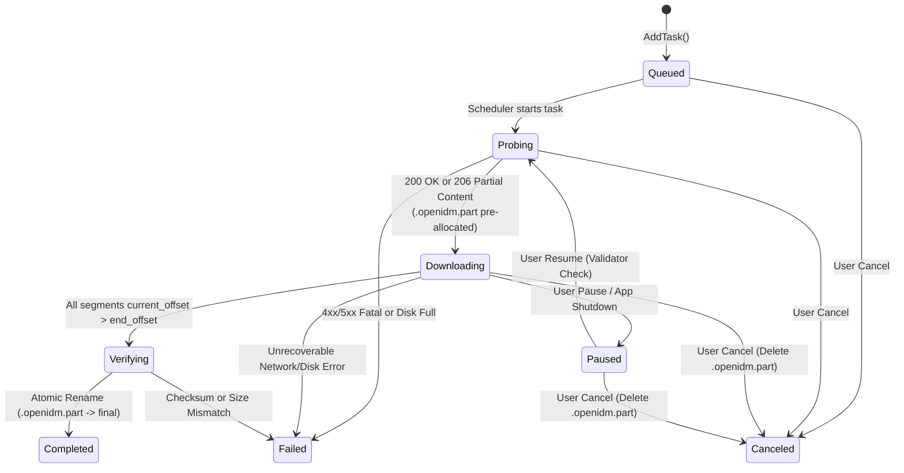

# Ordinary File Download Engine Design

**Document Status:** Proposed Subsystem Specification  
**Last Reviewed:** 2026-10-16  
**Scope:** Architecture, C++20 interfaces, dynamic connection spawning, work-stealing byte-range splitting, HTTP range detection, disk I/O, and crash-safe recovery for `src/engine_http/`.  
**Related Documents:** [SYSTEM_ARCHITECTURE.md](SYSTEM_ARCHITECTURE.md), [DATA_MODEL_AND_STORAGE.md](DATA_MODEL_AND_STORAGE.md), [ERROR_HANDLING_AND_RECOVERY.md](ERROR_HANDLING_AND_RECOVERY.md), [adr/0005-download-engine-integration.md](adr/0005-download-engine-integration.md)

---

## 1. Design Objectives & Upstream Inspiration

The Ordinary File Download Engine (`openidm::engine::WinHttpDownloadEngine`) handles all direct HTTP/1.1 and HTTP/2 single-file transfers (`.zip`, `.iso`, `.exe`, `.pdf`, and progressive `.mp4`/`.webm` video files). It adapts the three core algorithmic innovations of [Brisk Download Manager](https://github.com/BrisklyDev/brisk) into native C++20 on top of the Windows `WinHTTP` asynchronous API and Windows I/O Completion Ports (IOCP):
1. **Dynamic Connection Spawning (`FR-003`):** Starts every download with a single connection (`Worker 0`) and spawns additional workers (`1 .. N-1`) only after byte-range capability is confirmed and active throughput justifies concurrency.
2. **Dynamic Connection Reuse / Work-Stealing (`FR-003`):** When any worker finishes its assigned `[start_offset, end_offset]` range, it immediately steals the back half of the largest remaining active segment (`>= 2 MiB` left), keeping all connections busy until the final megabyte.
3. **Automatic Stall Reset (`FR-004`):** Monitors per-worker sliding-window throughput and resets individual hung connections at their exact persisted `current_offset` without failing the task.

---

## 2. Task & Segment State Machine



---

## 3. HTTP Range Detection & Non-Range Server Fallback (`FR-001`, `FR-002`)

Servers frequently misreport or inconsistently implement HTTP byte ranges. `WinHttpDownloadEngine` executes a strict 2-step probe protocol before spawning workers:

### 3.1 Step 1 — Initial `GET` with `Range: bytes=0-`
Instead of relying solely on `HEAD` (which many signed CDNs such as AWS S3 pre-signed GET URLs reject with `403 Forbidden` because the signature covers only the `GET` method), `Worker 0` sends an initial **`GET` request with `Range: bytes=0-`** and custom headers (`Referer`, `User-Agent`, `Cookie`):
1. **Case A — Server responds `206 Partial Content` with valid `Content-Range: bytes 0-<last>/<total>`:**
   - `range_supported = true`, `total_bytes = <total>`, `pause_supported = true`.
   - Record `ETag` (if strong, i.e., not prefixed with `W/`) and `Last-Modified` validators.
   - `Worker 0` immediately continues streaming body bytes from this already-open connection while the `SegmentScheduler` evaluates spawning `Worker 1 .. K-1`.
2. **Case B — Server responds `200 OK` with `Content-Length: <total>`:**
   - Check if `Accept-Ranges: bytes` header is explicitly present.
   - If `Accept-Ranges: bytes` is absent or `none`, set `range_supported = false`, `pause_supported = false`, and continue downloading the entire file on `Worker 0` alone without spawning additional connections (`FR-002`).
   - If `Accept-Ranges: bytes` is present (some servers ignore `Range: bytes=0-` with open-ended range), `Worker 1` tests `Range: bytes=<mid>-<total-1>`. Only if `Worker 1` receives `206 Partial Content` is `range_supported` upgraded to `true`.
3. **Case C — Server responds `200 OK` with `Transfer-Encoding: chunked` (No `Content-Length`):**
   - `range_supported = false`, `total_bytes = 0 (Unknown)`, `pause_supported = false`.
   - Download proceeds on `Worker 0` alone, appending sequentially to `<filename>.openidm.part`.

### 3.2 Guard Against Misbehaving Servers During Multi-Segment Transfers (`RISK-006`)
Every secondary worker (`Worker 1 .. N-1`) requests `Range: bytes=<start>-<end>`. Upon receiving headers (`WINHTTP_CALLBACK_STATUS_HEADERS_AVAILABLE`):
- If HTTP status is **not `206 Partial Content`** (for example, the server ignores the `Range` header and returns `200 OK` from byte 0), the worker **immediately closes the request handle without writing a single byte to disk**, disables further connection spawning for that task, and logs `WARN_SERVER_IGNORED_RANGE`.
- Furthermore, the worker parses `Content-Range: bytes <resp_start>-<resp_end>/<resp_total>` and verifies `resp_start == requested_start` and `resp_total == task.total_bytes` before writing to disk.

5. **Dynamic Concurrency Scaling & Network Resilience (`FR-003`, `FR-004`):**
   - **Secondary Range Capability Probe (`Case B`):** If the initial probe returns `200 OK` with `Accept-Ranges: bytes` and `Content-Length > min_split_bytes`, the engine performs an active single-byte verification probe (`Range: bytes=total/2..total/2`). If the server confirms `206 Partial Content`, `range_supported` is upgraded to `true`. If the server rejects the partial request, the engine safely falls back to single-stream sequential downloading.
   - **HTTP 429 (`Too Many Requests`) Adaptive Recovery:** When a `429` response is encountered during probing or active segment downloads, the engine parses `Retry-After` (supporting integer seconds and RFC 7231 / RFC 1123 HTTP-date formats like `Wed, 21 Oct 2026 07:28:00 GMT`), calls `SegmentScheduler::ReduceConnectionsByHalf()`, disables further segment splitting, and performs a non-blocking cancellation-aware sleep before resuming workers.
   - **Connection Reset / Server Connection Limit Detection:** On encountering transient connection resets (`ERR_NET_CONNECTION_RESET`, `ERROR_WINHTTP_CONNECTION_ERROR` codes `12030`/`12031`), connection drops (`ERR_NET_CONNECT`), or socket timeouts (`ERR_NET_TIMEOUT`), consecutive failure counters track instability. After `3` consecutive failures, concurrency is halved (`ReduceConnectionsByHalf()`); after `12` cumulative failures without forward progress, the task transitions cleanly to a resumable state.

---

## 4. Dynamic Connection Spawning & Work-Stealing Algorithm (`FR-003`)

### 4.1 Parameters & Thresholds (Current Source)
- The controller defaults to 8 connections per task; the HTTP engine clamps the task value to `1..32`.
- `SegmentScheduler` uses the configured `min_split_bytes` with an effective minimum separation of at least `256 KiB`.
- The coordinator checks for additional workers every `50 ms`.

### 4.2 Dynamic Ramp-Up
1. The engine starts `min(2, max_connections)` worker threads immediately.
2. Every `50 ms`, the coordinator may start one additional worker if the running thread count is below the configured/adaptive limit and the scheduler has unassigned work or a splittable active segment.
3. Consequently, a very fast transfer can finish before the full configured concurrency is reached. The worker-thread count is not a measurement of live HTTP requests.

### 4.3 Dynamic Work-Stealing Byte-Range Split
When a worker asks the scheduler for work and there is no unassigned segment:
1. `SegmentScheduler::AcquireNextOrStealSegment` scans active segments `j` for the largest remaining byte range:
   $$\text{remaining}_j = \text{end\_offset}_j - \text{current\_offset}_j + 1$$
2. If the selected remainder is large enough, it splits around the midpoint, aligned to a `4 KiB` boundary where possible, and shrinks the existing segment's end offset.
3. A worker may already have issued a `Range` request using the segment's previous end offset. The end change does not interrupt synchronous `WinHttpReadData`; cancellation is requested by the callback when the next body chunk arrives (or after the read timeout). `current_offset` advances only after a successful partial-file write, so it does not include bytes already returned in a read buffer. Under `write_mu`, the callback caps writes at the new end and discards any bytes beyond it; the newly assigned worker requests the suffix. Those discarded read-buffer bytes are fetched again if the new request needs them. This preserves the committed byte map, but can waste client-received data and request setup.
4. `LiveSegment::split_pending` prevents the scheduler from shrinking that same segment again while a request still has a stale end bound. It clears when a request using the current end reaches validated headers, or when an unstarted stolen range is rolled back. This bounds each in-flight response to one pending boundary change while retaining dynamic segmentation.
5. The coordinator snapshots progress for callbacks on its roughly `100 ms` progress cadence; segment changes are not transactionally persisted before each request is issued. `current_offset` reflects successful writes, not a durable flush; the engine flushes the shared part file after workers join, and recovery applies its existing safety rollback.

**Measured diagnostic (2026-10-25):** With an artificial 200 ms delay before the first response-body chunk and 5 ms pacing after each 256 KiB chunk, 16 MiB / 8-connection local runs reduced median engine transfer time from 770 ms (3 baseline runs) to 516 ms (5 guarded runs). Range requests fell from 17 to 6 and split cancellations from 11 to 5. Every run received and committed exactly 16 MiB and passed SHA-256. This controlled result supports the in-flight resplit guard for repeated request churn; it does not establish a public-network or IDM speed advantage. The trace is enabled only when `RADIUM_HTTP_RANGE_TRACE` is set. Client bytes count body data delivered to the engine callback, while server socket-write counters remain separate and are not packet-level traffic measurements.

---

## 5. Disk Writes, Pre-Allocation, and File Integrity (`FR-026`)

1. **Shared Partial File:** The Windows implementation opens `<dest_dir>\\<filename>.openidm.part` with `CreateFileW` using `GENERIC_READ | GENERIC_WRITE`, `FILE_SHARE_READ | FILE_SHARE_WRITE`, `OPEN_ALWAYS`, and `FILE_ATTRIBUTE_NORMAL`. It sets the logical length with `SetFilePointerEx` and `SetEndOfFile`.
2. **Synchronous Chunk Handling:** Each `PerformGet` reads with a reusable `256 KiB` buffer via synchronous `WinHttpReadData`; the worker callback writes the received chunk through `PlatformPartFile::PWrite` at the segment offset. Disk-write and per-segment lock wait times are not currently measured.
3. **Final Flush & Commit:** After workers join, the engine calls `FlushFileBuffers` before finalizing the partial file. Any configured checksum is verified before the final path is committed.
   - If the user provided an expected checksum (`SHA-256` / `MD5`), stream `.openidm.part` through Windows CNG (`BCryptHashData`).
   - Atomically rename `<filename>.openidm.part` to `<filename>` via `SetFileInformationByHandle` (`FileRenameInfoEx`), applying the configured conflict policy (`Auto-Rename`, `Overwrite`, or `Prompt`).

---

## 6. C++20 Engine Interface (`src/engine_http/IFileDownloadEngine.hpp`)

```cpp
// SPDX-License-Identifier: GPL-3.0-or-later
#pragma once
#include <cstdint>
#include <functional>
#include <string>
#include <vector>
#include "common/result.hpp"

namespace openidm::engine {

struct SegmentState {
    uint32_t segment_id{};
    uint64_t start_offset{};
    uint64_t current_offset{};
    uint64_t end_offset{}; // Inclusive; UINT64_MAX if unknown length
    bool completed{false};
};

struct FileDownloadSpec {
    std::string task_id;
    std::string url;
    std::wstring part_file_path;
    std::vector<std::pair<std::string, std::string>> headers; // Referer, User-Agent, Cookie
    uint32_t max_connections{8};
    uint64_t speed_limit_bytes_per_sec{0}; // 0 = unlimited
    std::string expected_etag;
    std::string expected_last_modified;
    uint64_t expected_total_bytes{0};
    std::vector<SegmentState> resume_segments;
};

struct FileProgressEvent {
    std::string task_id;
    uint64_t downloaded_bytes{};
    uint64_t total_bytes{};
    uint64_t speed_bytes_per_sec{};
    bool range_supported{false};
    std::vector<SegmentState> segments;
};

class IFileDownloadEngine {
public:
    virtual ~IFileDownloadEngine() = default;

    using ProgressCallback = std::function<void(const FileProgressEvent&)>;
    using CompletionCallback = std::function<void(const std::string& task_id, Result<void, EngineError>)>;

    virtual Result<void, EngineError> StartTask(
        const FileDownloadSpec& spec,
        ProgressCallback on_progress,
        CompletionCallback on_complete) = 0;

    virtual Result<void, EngineError> PauseTask(const std::string& task_id) = 0;
    virtual Result<void, EngineError> CancelTask(const std::string& task_id) = 0;
    virtual void SetTaskSpeedLimit(const std::string& task_id, uint64_t bytes_per_sec) = 0;
};

} // namespace openidm::engine

## Opt-in runtime performance telemetry

Set `RADIUM_HTTP_RANGE_TRACE=1` in the process environment to emit structured HTTP runtime events. Request start/end events use monotonic elapsed microseconds and include worker/segment IDs, requested byte range, response status, callback bytes received, bytes successfully written, measured request duration, cancellation outcome, and the number of active HTTP requests after each transition. Worker start/stop events report the observed active worker count and cumulative time spent waiting for work. Successful scheduler splits emit exact parent and child range boundaries. Retry events report requested backoff and measured elapsed wait. These events contain no URL or request headers.

`HTTP_PHASE_TRACE` records initialization start, transfer start/end, and finalization start/end from the same monotonic engine clock. Initialization includes probing and setup; transfer ends after workers join and the part file is flushed; finalization includes optional digest verification and atomic commit. Request completion events separately accumulate time spent in the task/global bandwidth limiters; worker stop and retry events report idle and backoff waits. The local benchmark independently compares in-process request starts and byte ranges against loopback server GET logs and checks written-byte totals, final size, and SHA-256. Runtime telemetry is diagnostic-only and does not feed scheduler decisions. Server socket-write counts remain separate because they measure bytes offered by the fixture, not bytes received by Radium.
```
