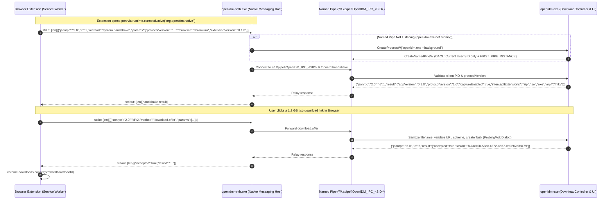

# Native Messaging and Local IPC Protocol Specification

**Document Status:** Proposed Protocol Specification
**Last Reviewed:** 2026-10-16
**Scope:** End-to-end wire protocol, message schemas, authentication, timeouts, error codes, and lifecycle management between the Browser Extension, `openidm-nmh.exe`, and `openidm.exe`.
**Related Documents:** [SYSTEM_ARCHITECTURE.md](SYSTEM_ARCHITECTURE.md), [BROWSER_EXTENSION.md](BROWSER_EXTENSION.md), [SECURITY_THREAT_MODEL.md](SECURITY_THREAT_MODEL.md), [adr/0003-browser-communication.md](adr/0003-browser-communication.md)

---

## 1. End-to-End IPC Topology

1. **Leg 1 (Browser <-> `openidm-nmh.exe`):** Standard Browser Native Messaging over `stdin`/`stdout`. Each frame consists of a 32-bit native-endian (`uint32_le` on x64/ARM64) byte length prefix followed by a UTF-8 JSON-RPC 2.0 object.
2. **Leg 2 (`openidm-nmh.exe` <-> `openidm.exe`):** Windows Named Pipe (`\\\\.\\pipe\\OpenIDM_IPC_<UserSID>`) configured in `PIPE_TYPE_MESSAGE | PIPE_READMODE_MESSAGE | PIPE_WAIT` mode with `FILE_FLAG_OVERLAPPED`. Uses the exact same 32-bit length-prefixed UTF-8 JSON-RPC 2.0 framing so `openidm-nmh.exe` operates as a fast, zero-reparse framing proxy after validating message bounds.

---

## 2. Sequence Diagram: Adding a New Download from the Browser



---

## 3. Native Messaging Host Manifests

### 3.1 Chromium (`com.flux.downloadmanager.chromium.json`)
Registered at `HKCU\\Software\\Google\\Chrome\\NativeMessagingHosts\\com.flux.downloadmanager` (and equivalent `Microsoft\\Edge` and `BraveSoftware\\Brave-Browser` keys):
```json
{
  "name": "com.flux.downloadmanager",
  "description": "Flux Download Manager Native Messaging Host",
  "path": "C:\\Program Files\\Flux Download Manager\\radium-nmh.exe",
  "type": "stdio",
  "allowed_origins": [
    "chrome-extension://mdgmlcnpodoehidlplplfegngnjnilap/",
    "chrome-extension://chbojfoombcanhhpoclailollapkglma/"
  ]
}
```

### 3.2 Firefox (`org.openidm.native.firefox.json`)
Registered at `HKCU\\Software\\Mozilla\\NativeMessagingHosts\\org.openidm.native`:
```json
{
  "name": "org.openidm.native",
  "description": "OpenIDM Native Messaging Host Bridge",
  "path": "C:\\Program Files\\OpenIDM\\openidm-nmh.exe",
  "type": "stdio",
  "allowed_extensions": [
    "extension@openidm.org"
  ]
}
```

---

## 4. Authentication, Authorization & Security Controls

1. **Browser-to-NMH Authentication:** Enforced by the browser via `allowed_origins` / `allowed_extensions`.
2. **NMH-to-Desktop Named Pipe Authentication (`NFR-008`):**
   - `openidm.exe` queries its own process token (`OpenProcessToken` + `GetTokenInformation(..., TokenUser, ...)`) to obtain the current user's string SID (e.g., `S-1-5-21-...`) via `ConvertSidToStringSidW`.
   - Creates `\\\\.\\pipe\\OpenIDM_IPC_<UserSID>` with `dwOpenMode = PIPE_ACCESS_DUPLEX | FILE_FLAG_OVERLAPPED | FILE_FLAG_FIRST_PIPE_INSTANCE`.
   - Attaches a custom `SECURITY_DESCRIPTOR` parsed via `ConvertStringSecurityDescriptorToSecurityDescriptorW`:
     `D:P(A;;GA;;;SY)(A;;GA;;;<UserSID>)` — granting Generic All **only** to `SYSTEM` and `<UserSID>`, and implicitly denying all other local users, guest accounts, and network logons (`PIPE_REJECT_REMOTE_CLIENTS` is also set in `dwPipeMode`).
   - Upon `ConnectNamedPipe`, `openidm.exe` calls `GetNamedPipeClientProcessId` and `QueryFullProcessImageNameW` to verify the connecting client executable is `<install_dir>\\openidm-nmh.exe`.
3. **Strict Privilege Boundary:**
   - The IPC protocol **never** exposes generic file write, shell execution, or raw CLI flag pass-through methods. Only the 6 structured RPC methods in Section 5 exist.

---

## 5. Message Catalog & JSON-RPC 2.0 Schemas

### 5.1 Limits, Timeouts, and Version Negotiation
- **Max Message Size:** `1,048,576` bytes (`1 MiB`, matching Chromium's Native Messaging host-to-extension limit). `radium-nmh.exe` enforces this limit on stdout frames, returning a standard JSON-RPC 2.0 error frame (`-32603`) if an outgoing response exceeds 1 MiB instead of causing browser host termination. Both NMH and desktop drop incoming frames exceeding 1 MiB.
- **Version Negotiation:** Major.Minor (`"1.0"`). If `major` versions differ, `system.handshake` returns error `-32001` (`ERR_IPC_VERSION_MISMATCH`) and the extension displays an `"Update OpenIDM Desktop / Extension"` banner.
- **Timeouts & Concurrency:**
  - `system.handshake`: `1,500 ms` (allows time for cold start of `radium.exe --daemon`).
  - `download.offer`: `5,000 ms` (if exceeded, extension safely resumes download in browser).
  - `stream.add`: `2,000 ms` (acknowledges receipt and opens desktop Track Selection dialog).
  - **Named Pipe Concurrency:** Client connection attempts in `src/nmh/main.cpp` intercept `ERROR_PIPE_BUSY` from `CreateFileW` and call `WaitNamedPipeW(..., 3000)` to wait for an available pipe instance, preventing false offline detections and duplicate background daemon spawns under concurrent tab requests.

### 5.2 Method Specifications

| Method | Direction | Purpose |
| :--- | :--- | :--- |
| `system.handshake` | Extension -> Desktop | Negotiate protocol version and fetch current desktop capture settings (enabled state, file extensions, min size). |
| `system.ConfigUpdated` | Desktop -> Extension (Notification) | Pushed when the user modifies capture settings or exclusion domains in the desktop UI. |
| `download.offer` | Extension -> Desktop | Offer an intercepted ordinary file download (`URL`, `filename`, `fileSize`, `headers`, `tabUrl`, `correlationId`). Returns `{ accepted: bool, taskId: string }`. Deduplicated idempotently by URL or `correlationId`. |
| `download.startChunkedTransfer` | Extension -> Desktop | Initiates a bounded chunked staging session for client-generated files or IPC file transfers. Returns `{ accepted: bool, taskId: string, chunkSize: int }`. (Note: in-browser web app blob/data downloads are kept natively in browser). |
| `download.transferChunk` | Extension -> Desktop | Transfers a single base64-encoded chunk into the staging file in `%LOCALAPPDATA%\Flux\tmp\`. Returns `{ received: bool, chunkIndex: int, bytesWritten: int }`. |
| `download.completeChunkedTransfer` | Extension -> Desktop | Finalizes the staged file, verifies size, moves it to the destination directory, runs Defender scan, and records the task as `COMPLETED`. |
| `download.abortChunkedTransfer` | Extension -> Desktop | Aborts a chunked transfer session and cleans up temporary staging files. |
| `download.batchAdd` | Extension -> Desktop | Send a list of links extracted from a webpage text selection (`FR-010`) to open the Desktop Batch Download Dialog. |
| `stream.add` | Extension -> Desktop | Triggered when user clicks the in-page "Download Video" button or a stream item in the popup. Passes the `MediaCandidateDescriptor` to launch the Desktop Stream Probe & Track Selection Dialog (`FR-019`). |
| `task.cancel` | Extension -> Desktop | Optional cancellation of a pending probe initiated from the extension popup. |

### 5.3 Example JSON Messages

#### Request: `stream.add` (Adding an HLS Stream Detected in Browser)
```json
{
  "jsonrpc": "2.0",
  "id": "req-9042",
  "method": "stream.add",
  "params": {
    "candidateId": "cand-7c9e6679",
    "streamType": "HLS",
    "manifestUrl": "https://vod-cdn.example.com/courses/cs101/master.m3u8?token=eyJhbGci...",
    "cachedManifestBody": null,
    "pageTitle": "CS101 Lecture 4 - Operating Systems",
    "tabUrl": "https://learn.example.com/courses/cs101/lecture-4",
    "frameUrl": "https://player.example.com/embed/lecture-4",
    "isLive": false,
    "headers": {
      "Referer": "https://player.example.com/",
      "Origin": "https://player.example.com",
      "User-Agent": "Mozilla/5.0 (Windows NT 10.0; Win64; x64) AppleWebKit/537.36 (KHTML, like Gecko) Chrome/130.0.0.0 Safari/537.36",
      "Cookie": "session_token=REDACTED_IN_LOGS; cf_clearance=REDACTED_IN_LOGS"
    },
    "detectedSubtitles": [
      {
        "url": "https://vod-cdn.example.com/courses/cs101/subs_en.vtt",
        "lang": "en",
        "label": "English"
      }
    ]
  }
}
```

#### Response: `stream.add`
```json
{
  "jsonrpc": "2.0",
  "id": "req-9042",
  "result": {
    "accepted": true,
    "taskId": "550e8400-e29b-41d4-a716-446655440000",
    "status": "PROBING_MANIFEST"
  }
}
```

---

## 6. Error Codes, Disconnection Recovery & Redaction

| JSON-RPC Error Code | Symbolic Name | Meaning & Recovery Behavior |
| :--- | :--- | :--- |
| `-32700` | `ERR_IPC_PARSE_ERROR` | Malformed JSON frame; connection closed immediately. |
| `-32600` | `ERR_IPC_INVALID_REQUEST` | Missing required fields or failed schema validation. |
| `-32602` | `ERR_IPC_UNSAFE_URL_OR_PATH` | URL scheme is not `http:`/`https:`, or parameters failed validation. |
| `-32001` | `ERR_IPC_VERSION_MISMATCH` | Incompatible protocol major version; prompt user to update. |
| `-32002` | `ERR_IPC_CAPTURE_DISABLED` | User paused automatic browser capture in OpenIDM tray menu; extension leaves download in browser. |
| `-32003` | `ERR_IPC_DESKTOP_BUSY` | Desktop app is shutting down; extension falls back to browser download. |
| `-32003` | `ERR_IPC_DESKTOP_UNAVAILABLE` | Named pipe not found or desktop not running; extension safely falls back to native browser download. |
| `-32003` | `ERR_IPC_DISCONNECTED` | Named pipe disconnected mid-write; extension triggers safe fallback. |
| `-32003` | `ERR_IPC_BAD_RESPONSE` | Pipe read failed or response frame corrupted; triggers safe fallback. |
| `-32600` | `ERR_IPC_FRAME_SIZE` | Input frame length exceeds 1 MiB limit; NMH returns error frame. |

### 8. Native Messaging Host (`src/nmh/main.cpp`) Framing & Hardening

1. **Exact I/O Framing Across OS Chunk Boundaries:**
   - Standard input and output message length headers are strictly 32-bit little-endian integers (`uint32_t`).
   - `ReadExact(FILE*, void*, size_t)` and `ReadPipeExact(HANDLE, void*, size_t)` loop until all bytes are transferred or EOF is hit, preventing partial frame truncation when OS buffers chunk large payloads.
   - `WritePipeExact(HANDLE, const void*, size_t)` ensures complete delivery of payloads into the Windows Named Pipe.

2. **JSON-RPC Request-ID Preservation in NMH Error Frames:**
   - To ensure Chromium and Firefox MV3 promise-based RPC callers correctly match responses to in-flight requests, `ExtractJsonRpcId()` inspects incoming JSON payloads for `"id": <value>`.
   - When the desktop app is offline (`ERR_IPC_DESKTOP_UNAVAILABLE`), disconnected (`ERR_IPC_DISCONNECTED`), or returns a bad frame (`ERR_IPC_BAD_RESPONSE`), the NMH echoes the exact incoming request `id` (e.g. `{"jsonrpc":"2.0","id":"ext-1","error":{...}}`) rather than returning a generic `null` id.

3. **Disconnection Recovery & 5,000 ms Timeout:**
   - If the Native Messaging port disconnects or `radium.exe` does not respond within 5,000 ms, the extension aborts the RPC wait, resolves `suggest({ filename })`, and resumes the native browser download without hanging the user's browser.
   - Named Pipe reconnects wait on `WaitNamedPipeW` with 3,000 ms timeout upon `ERROR_PIPE_BUSY` to prevent thrashing under concurrent multi-tab downloads.
   - **Logging & Redaction:** The IPC layer never logs `params.headers.Cookie`, `Authorization`, or sensitive query parameters matching token patterns (`NFR-009`).
