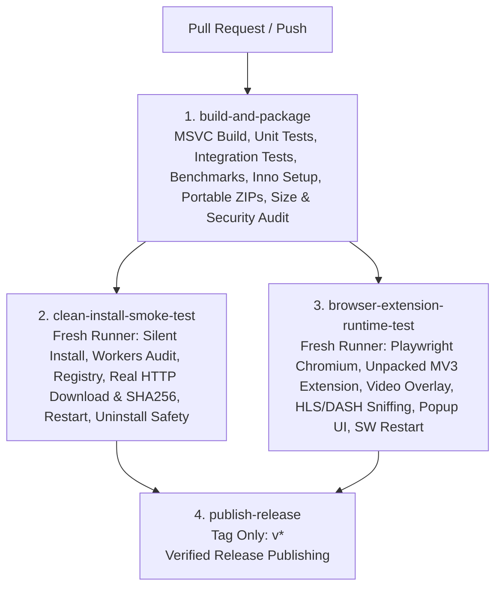

# Test Strategy Specification

**Document Status:** Proposed Test Architecture
**Last Reviewed:** 2026-10-16
**Scope:** Unit, deterministic local integration, browser end-to-end, security fuzzing, crash recovery, and installer validation strategy.
**Related Documents:** [TEST_MATRIX.md](TEST_MATRIX.md), [PRODUCT_REQUIREMENTS.md](PRODUCT_REQUIREMENTS.md), [SECURITY_THREAT_MODEL.md](SECURITY_THREAT_MODEL.md), [ERROR_HANDLING_AND_RECOVERY.md](ERROR_HANDLING_AND_RECOVERY.md)

---

## 1. Core Testing Principles

1. **100% Deterministic Local Integration Testing:** Network downloaders and stream parsers must **never** rely on external public websites (such as YouTube or live CDNs) for automated CI tests. All HTTP range behaviors, mid-transfer stalls, expired tokens, HLS `.m3u8` playlists, and DASH `.mpd` manifests are served by a **Deterministic Local Fault-Injection Test Server** (`tests/integration/local_test_server.py`).
2. **Engine Decoupling (`NFR-014`):** Because `DownloadController` depends on pure abstract C++ interfaces (`IFileDownloadEngine`, `IStreamDownloadEngine`), queue scheduling, concurrency limits, state transitions, and SQLite persistence can be unit-tested at thousands of iterations per second without opening sockets.
3. **Honest Execution Status:** Every test in [TEST_MATRIX.md](TEST_MATRIX.md) is tracked separately as `Planned`, `Implemented`, `Passed`, `Failed`, or `Blocked (Environment)`.

---

## 2. Test Pyramid & Frameworks

| Test Layer | Framework / Tooling | Scope & Target Modules | Execution Environment |
| :--- | :--- | :--- | :--- |
| **1. C++20 Unit Tests (`UT-*`)** | **GoogleTest (`gtest` / `gmock`)** via CTest | `SegmentScheduler` (work-stealing math), `PathSanitizer` (traversal/ADS/DOS names), `Logger` (credential redaction), `MetaJsonParser` (`N_m3u8DL-RE` JSON parsing & DRM detection), `SqliteStore` CRUD & migrations, `QueueScheduler`. | Runs in `< 5 seconds` on every developer build and CI commit. |
| **2. TypeScript Extension Unit Tests (`UT-EXT-*`)** | **Vitest** | `MediaSniffer` MIME/URL classification, segment suppression filters, `ManifestDeduplicator` master/child grouping, `PolicyRules` site exclusion matching. | Runs in `< 3 seconds` via `npm test` in `extension/`. |
| **3. Deterministic Network & Stream Integration Tests (`IT-*`)** | **GoogleTest + Python `aiohttp` Fault-Injection Test Server + FFmpeg Synthetic Fixtures** | End-to-end `WinHttpDownloadEngine` and `Nm3u8dlReAdapter` tests against controlled HTTP/1.1 & HTTPS endpoints simulating range support, non-range fallback, stalled sockets, `403` token expiry, `ETag` mismatch, VOD HLS, AES-128 HLS, and VOD DASH. | Runs in `< 60 seconds` on Windows 11 dev machines and GitHub Actions `windows-latest`. |
| **4. Crash & Power-Loss Recovery Tests (`IT-CRASH-*`)** | **GoogleTest Subprocess Harness (`TerminateProcess`)** | Spawns `openidm.exe` downloading a 256 MiB file at a throttled speed, forcibly kills it via `TerminateProcess(hProc, 9)` at 50%, relaunches `openidm.exe`, resumes the download, and verifies the final output's `SHA-256` digest and zero orphaned `N_m3u8DL-RE.exe` workers. | Windows 11 CI & local dev host. |
| **5. Browser End-to-End Tests (`E2E-*`)** | **Playwright (Chromium & Firefox)** | Launches Chromium/Edge with the unpacked extension loaded and `openidm-nmh.exe` registered; navigates to local test pages containing `.zip` download links, progressive `<video>` players, cross-origin iframes, and `hls.js`/`dash.js` MSE players; clicks the Shadow DOM overlay button and verifies IPC delivery to `openidm.exe`. | Windows 11 GUI session / CI runner. |
| **6. Security & Fuzz Tests (`SEC-*`)** | **GoogleTest + Adversarial Payload Corpus** | Path traversal fuzzing (`Content-Disposition`), `@job.rsp` CLI flag injection attempts, hostile `.m3u8` with `file://` / `127.0.0.1` SSRF URIs, Named Pipe DACL cross-user rejection, DPAPI blob inspection, and DLL hijacking checks. | Windows 11 CI & local dev host. |
| **7. System, Installer & Performance Tests (`SYS-*`, `PERF-*`)** | **Windows Sandbox (`.wsb`) + PowerShell Verification Scripts** | Clean-machine installation (`OpenIDM-Setup-x64-Full.exe`), upgrade preservation of `state.db`, clean uninstallation, High-DPI scaling (`100%`–`225%`), and 1 Gbps loopback saturation benchmarks. | Clean Windows 11 VM / Sandbox. |

---

## 3. Deterministic Local Test Server & Media Fixture Design (`tests/integration/`)

To avoid storing large binary video files in Git, `tests/integration/generate_fixtures.py` uses `ffmpeg.exe` at test initialization time to synthesize deterministic, copyright-free media fixtures in `< 2 seconds`:
1. **Progressive MP4 & WebM (`test_progressive.mp4`, `test_progressive.webm`):**
   - Generated via `ffmpeg -f lavfi -i testsrc=duration=10:size=1280x720:rate=30 -f lavfi -i sine=frequency=1000:duration=10 ...`.
   - Known exact `SHA-256` computed at fixture generation time.
2. **Multi-Variant HLS Fixture (`hls_vod/master.m3u8`):**
   - Contains two video variants (`1080p` and `480p`), a separate English audio rendition (`#EXT-X-MEDIA:TYPE=AUDIO`), and a WebVTT subtitle track (`#EXT-X-MEDIA:TYPE=SUBTITLES`), split into five 2-second `.ts` segments.
3. **Standard AES-128 Encrypted HLS Fixture (`hls_aes128/index.m3u8`):**
   - Encrypted with a known 16-byte key served at `http://127.0.0.1:<port>/keys/key.bin` requiring header `Cookie: test_session=valid_cookie`.
4. **MPEG-DASH Fixture (`dash_vod/manifest.mpd`):**
   - Generated via `ffmpeg -f dash` with fragmented MP4 (`init-stream$RepresentationID$.m4s` and `chunk-stream$RepresentationID$-$Number%05d$.m4s`).
5. **Simulated Fault Endpoints on `local_test_server.py`:**
   - `/range/normal.bin` — Supports `206 Partial Content` for arbitrary byte ranges over a deterministic pseudo-random byte stream (seeded PRNG so a 512 MiB stream can be generated on the fly with zero disk storage!).
   - `/range/no-range.bin` — Always ignores `Range` header and returns `200 OK` from byte 0 (`IT-HTTP-02`).
   - `/range/misbehaving-200-on-worker2.bin` — Returns `206` on connection 1, then returns `200 OK` (full file) on connection 2 (`RISK-006`).
   - `/range/stall-worker3.bin` — Stops sending bytes on the 3rd connection after `256 KiB` for 20 seconds (`IT-HTTP-04`).
   - `/range/expiring-token.bin?token=t1` — Accepts `token=t1` for the first `10 MiB`, then returns `403 Forbidden` until resumed with `token=t2` (`IT-HTTP-06`).
   - `/range/etag-mutating.bin` — Changes `ETag` from `"v1"` to `"v2"` while paused (`IT-HTTP-05`).

---

## 4. GitHub-Only Production Readiness Testing Architecture (`windows-release.yml`)

To decouple developers from local workstation build or install burdens and ensure clean-machine determinism, all release validation is executed on GitHub-hosted `windows-2022` runners across four isolated pipeline jobs:

### 4.1 Job Breakdown & Responsibilities

1. **Job 1: `build-and-package` (Windows x64):**
   - Compiles native C++20 targets (`radium.exe`, `radium-nmh.exe`, `radium_unit_tests.exe`, `N_m3u8DL-RE.exe`).
   - Executes C++ regression suite (`radium_unit_tests.exe`), Node.js extension unit tests (`test_extension_detection.js`), Python integration tests (`run_all_integration_tests.py`), and performance benchmarks (`run-benchmarks.py`).
   - Compiles Inno Setup 6 installers (Full Offline and Core-Only) and packages standalone portable ZIP archives (`package-release-zip.ps1`).
   - Audits package size budgets (`report-package-sizes.ps1 -FailOnExceeded`) and release security integrity (`verify-release-security.ps1`).
   - Uploads distribution packages and test evidence as GitHub Actions artifacts.

2. **Job 2: `clean-install-smoke-test` (Fresh `windows-2022` Host):**
   - Downloads packaged release artifacts without sharing previous filesystem state.
   - Executes `python tests/test_installer_smoke.py`:
     - Installs Full setup installer silently (`/VERYSILENT /DIR=... /TYPE=full`).
     - Verifies application version, PE32+ AMD64 headers, bundled stream workers (`N_m3u8DL-RE.exe`, `ffmpeg.exe`, `yt-dlp.exe`), extension assets, and native messaging manifests (`com.flux.downloadmanager.chromium.json`).
     - Confirms HKCU registry bindings for Chrome and Edge.
     - Performs a real HTTP download through installed `radium.exe` against a controlled local test server and verifies exact byte size and SHA-256 digest.
     - Injects network reset to verify auto-resume, verifies 404 error exit code, checks zero leftover `.part` files, and verifies database restart persistence.
     - Launches installed application daemon and runs end-to-end positive Native Messaging exchange with Chromium, confirming `system.handshake`, `download.offer`, and SQLite task queue recording.
     - Uninstalls silently (`unins000.exe /VERYSILENT`) and verifies binary removal while strictly preserving `%LOCALAPPDATA%\Flux` user data.

3. **Job 3: `browser-extension-runtime-test` (Playwright Chromium on Fresh Host):**
   - Downloads packaged extension and installs Playwright with Chromium.
   - Executes `node tests/browser/test_extension_runtime.js`:
     - Launches Chromium with real unpacked Manifest V3 extension loaded.
     - Tests ordinary download link interception and non-blocking browser fallback (strictly asserting one of the two outcomes occurred).
     - Verifies HTML5 video detection, closed Shadow DOM overlay pill attachment, and candidate `source.mp4` registration in service worker.
     - Sniffs dynamic HLS `.m3u8` variant playlists and DASH `.mpd` manifests, strictly asserting exact stream types.
     - Navigates to popup UI (`popup.html`), verifying root rendering, essential controls, and search filtering without swallowing errors.
     - Audits real MV3 service worker lifecycle termination via Chrome DevTools Protocol (`ServiceWorker.stopWorker`/`startWorker`) and `chrome.storage.local` persistence.
     - Tests native messaging offline fallback contract when desktop application is offline.
     - Captures full-page screenshots and structured JSON test reports.

4. **Job 4: `publish-release` (Tag Gated):**
   - Strictly requires `needs: [build-and-package, clean-install-smoke-test, browser-extension-runtime-test]`.
   - Executes only on version tags (`refs/tags/v*`).
   - Holds exclusive `contents: write` permission to publish official GitHub Releases via `softprops/action-gh-release@v2`.

5. **Nightly Compatibility Lab (`nightly-live-compatibility.yml`):**
   - Scheduled daily at 02:00 UTC to test against live public websites (`tests/test_live_brave_verification.py`), ensuring upstream website changes never block deterministic release builds or pull requests.

